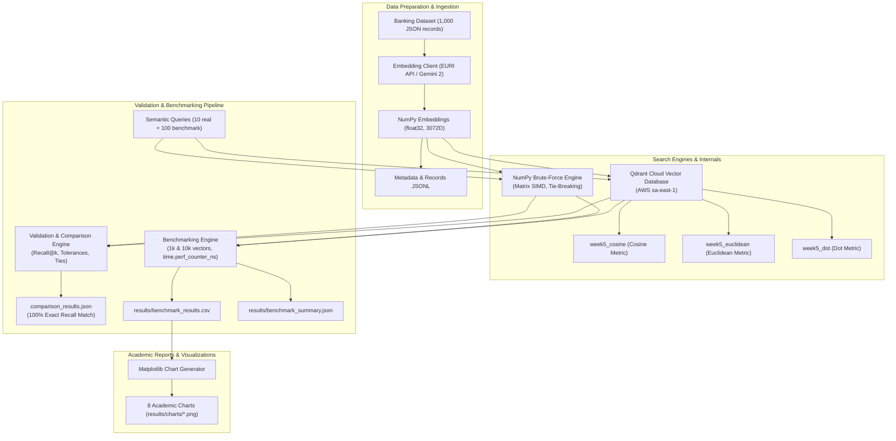

# System Architecture: Vector Search Internals

## 1. High-Level Architectural Diagram

---

## 2. Component Design & Responsibilities

### 2.1 Configuration Layer (`config/settings.py`)
- Centralized configuration management using `pydantic`/`dataclasses` and `python-dotenv`.
- Loads sensitive API keys securely from local `.env`.
- Defines runtime paths (`DATA_DIR`, `RESULTS_DIR`, `CHARTS_DIR`).

### 2.2 Mathematical Engine (`src/vector_math.py`)
- Independent, scratch Python implementations of:
  - Vector magnitude $\|v\|$
  - Dot product $a \cdot b$
  - Coordinate differences & squared differences
  - Euclidean distance $d(a, b)$
  - Cosine similarity $\cos \theta$
  - Vector $L_2$ normalization $\hat{v} = v / \|v\|$
- High-performance vectorized NumPy equivalents with SIMD broadcasting and strict dimension/finite validation.

### 2.3 Classroom Proof Module (`src/classroom_example.py`)
- Recreates 2D points $A(2,3), B(1,2), C(0,4)$ and query $Q(2,4)$.
- Computes and prints every intermediate step.
- Mathematically demonstrates why Euclidean ranking ($A \to C \to B$) differs from Cosine ranking ($B \to A \to C$).

### 2.4 Dataset & Embedding Pipeline (`src/dataset_manager.py`, `src/embedding_client.py`)
- Generates 1,000 structured banking records across 10 domains with realistic metadata.
- Integrates with EURI REST API for Google's `gemini-embedding-2` model.
- Automatically verifies actual vector dimension ($D = 3072$).
- Implements exponential backoff retries, batching, and on-disk caching to prevent repeated API calls.

### 2.5 Brute-Force Vector Search Engine (`src/brute_force_search.py`)
- Exhaustive $O(N \cdot D)$ similarity search.
- Precomputed $L_2$ norms for instantaneous cosine queries.
- Two-tier top-$k$ sorting:
  1. $O(N)$ candidate selection using `np.argpartition`.
  2. $O(k \log k)$ lexicographical sorting using `np.lexsort` for deterministic ID-based tie-breaking.

### 2.6 Qdrant Vector Database Integration (`src/qdrant_manager.py`)
- Official `qdrant-client` driver supporting local Docker and authenticated Qdrant Cloud.
- Automatic collection provisioning with dedicated distance metrics:
  - `COSINE`
  - `EUCLID`
  - `DOT`
- Batch upserts with payload attachment.
- Switchable query mode: `exact=True` for ground-truth verification vs `exact=False` for HNSW benchmark.

### 2.7 Validation Engine (`src/result_validator.py`)
- Automated cross-engine comparator.
- Checks top-$k$ ID overlap, Recall@k, score differences, and rank orders.
- Validates floating-point tolerance ($\text{atol}=10^{-4}$).

### 2.8 Benchmarking Suite (`src/benchmark.py`)
- Nanosecond-precision latency profiler (`time.perf_counter_ns`).
- Measures 6 search modalities across 1,000 and 10,000 vectors.
- Calculates Mean, Median, Min, Max, P95, P99, StdDev, QPS, and Recall@10.
- Exports tabular CSV and JSON reports.

### 2.9 Visualization Engine (`src/visualization.py`)
- Publication-quality academic charts using Matplotlib.
- Visualizes 2D geometry, ranking discrepancies, scaling curves, P95 tail latencies, and HNSW trade-offs.
