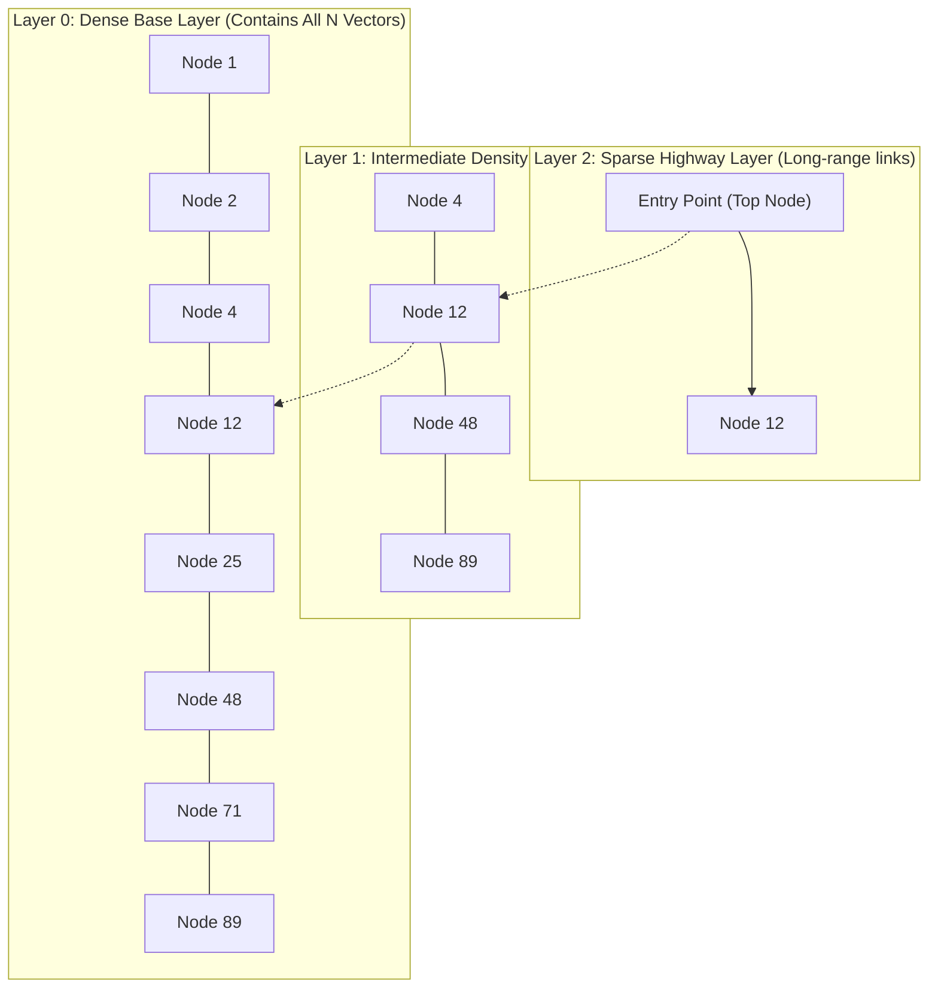

# Hierarchical Navigable Small World (HNSW) Indexing Explained

## 1. Executive Overview

In large-scale vector search, the fundamental algorithmic challenge is **Nearest Neighbor Search (NNS)**: given a query vector $q \in \mathbb{R}^D$ and a database of $N$ vectors $\{v_1, v_2, \dots, v_N\}$, identify the top-$k$ vectors that maximize similarity or minimize distance.

- **Brute-Force Search (Exact Search):** Computes the exact distance between $q$ and all $N$ vectors. The computational complexity is $O(N \cdot D)$, which scales linearly with the dataset size. For millions or billions of high-dimensional vectors, exact brute-force search becomes computationally prohibitive and exhibits high query latency.
- **Approximate Nearest Neighbor (ANN) Search:** Trades a tiny fraction of accuracy (e.g., achieving 95%–99% recall rather than 100%) in exchange for orders of magnitude faster query response times.
- **HNSW (Hierarchical Navigable Small World):** The premier state-of-the-art graph-based ANN algorithm, developed by Malkov & Yashunin (2018), powering production vector databases including Qdrant, Milvus, and FAISS.

---

## 2. Theoretical Foundations: What is HNSW?

### 2.1 The Small World Phenomenon
In graph theory, a **Small World network** is a graph where most nodes are not neighbors of one another, but the neighbors of any given node are likely to be neighbors of each other, and most nodes can be reached from every other node by a small number of hops (famously known as the "six degrees of separation").

### 2.2 Navigable Small World (NSW)
A standard Navigable Small World graph connects vectors such that:
1. Long-range edges connect distant parts of the vector space (providing rapid coarse routing).
2. Short-range edges connect closely related local vectors (providing fine-grained clustering).

However, basic NSW graphs suffer from search stagnation and logarithmic degradation as the graph grows, because local clustering can trap greedy routing algorithms in local minima.

### 2.3 The "Hierarchical" Innovation (HNSW)
HNSW borrows the brilliant multi-layer concept from **Skip Lists** (William Pugh, 1990) and applies it to multi-dimensional geometric graphs:

- **Top Layer (Layer $L$):** Sparse graph containing only a few nodes with very long-range connections. Search begins here and travels across vast distances across the vector space with single hops.
- **Intermediate Layers (Layer $L-1 \dots 1$):** Progressively denser graphs with intermediate edge lengths.
- **Bottom Layer (Layer 0):** Dense graph containing **every single vector** in the dataset, connected by short-range, highly localized neighbor edges.

---

## 3. How Search Works: Step-by-Step Traversal

When a query $q$ arrives:

1. **Enter at the Top:** The search starts at a predetermined global **Entry Point** node at the highest layer $L_{max}$.
2. **Greedy Routing at Upper Layers:**
   - The algorithm evaluates the distance from $q$ to the current node and all its connected neighbors.
   - It steps to whichever neighbor is closest to $q$.
   - This greedy hop repeats until no neighbor is closer to $q$ than the current node (a local minimum at this layer).
3. **Descend to the Next Layer:**
   - The current closest node becomes the entry point for the next layer down.
4. **Beam Search at Layer 0:**
   - Upon reaching Layer 0, the search switches from a simple 1-greedy step to a prioritized **beam search** tracking the top candidates in a dynamic priority queue of size $ef$.
   - The search visits neighbors, expands the frontier, and terminates when no closer candidates can be found.
   - The top-$k$ nearest neighbors from the priority queue are returned to the caller.

---

## 4. Key Hyperparameters Explained

The performance and accuracy of HNSW are governed by three crucial parameters:

| Hyperparameter | Scope | Default in Qdrant | Role & Effect |
|---|---|---|---|
| **`M`** | Index Build | 16 (range: 4–64) | **Maximum Number of Bi-directional Connections per Node.** • Higher $M$ increases connectivity and improves Recall@k, but increases index construction time and memory footprint (RAM). • Lower $M$ saves memory and speeds up building, but increases risk of disconnected clusters. |
| **`ef_construct`** | Index Build | 100 (range: 64–512) | **Candidate List Size During Index Construction.** • Governs the breadth of exploration when deciding which edges to wire between vectors during indexing. • Higher $ef\_construct$ dramatically improves graph quality and recall, but increases index construction time. Does not affect search memory. |
| **`hnsw_ef`** | Search Query | 64 (range: 16–512) | **Dynamic Candidate List Size During Search.** • Controls how many nearest candidates are held in the priority queue during Layer 0 search. • Higher $hnsw\_ef$ examines more neighbors, improving Recall@k at the expense of higher query latency. • Can be dynamically tuned per query at runtime without modifying the index! |

---

## 5. Exact Search vs Approximate HNSW Search

| Dimension | Brute-Force (NumPy / Qdrant Exact) | HNSW Approximate Search (Qdrant) |
|---|---|---|
| **Algorithmic Complexity** | $O(N \cdot D)$ linear | $O(\log N \cdot D)$ expected |
| **Recall@k Accuracy** | Exactly 100% (Ground Truth) | Typically 95%–99.9% (Configurable via $ef$) |
| **Index Build Time** | 0 ms (No indexing required) | High $O(N \log N)$ upfront building cost |
| **Memory Footprint** | Only raw vector storage ($\approx 4 \times N \times D$ bytes) | Vector storage + graph edge lists ($\approx 1.5\times$ to $2\times$ memory) |
| **Dynamic Inserts / Deletions** | Instantaneous | Requires graph edge rewiring / tombstoning |
| **1,000 Vectors Latency** | **Sub-millisecond (Fastest)** | Network API latency overhead dominates |
| **10,000,000 Vectors Latency** | Seconds to Minutes (Unusable) | **5–15 milliseconds (Instantaneous)** |

---

## 6. The Speed vs Accuracy Trade-Off: Recall@k

**Recall@k** measures what percentage of the true top-$k$ nearest neighbors (as computed by exact brute force) are successfully retrieved by the approximate search:

$$\text{Recall@k} = \frac{|\text{Top-}k_{\text{exact}} \cap \text{Top-}k_{\text{HNSW}}|}{k}$$

By varying `hnsw_ef` at query time:
- At `hnsw_ef = 16`: Very fast search (~2 ms engine time), Recall@10 $\approx$ 92%.
- At `hnsw_ef = 64`: Balanced search (~4 ms engine time), Recall@10 $\approx$ 98%–99%.
- At `hnsw_ef = 256`: Thorough search (~8 ms engine time), Recall@10 $\approx$ 99.8%.

---

## 7. When is Brute-Force Better? When is HNSW Better?

### When to Prefer Brute-Force Search:
1. **Small Datasets ($N < 50,000$):** As proven in our Phase 7 benchmarks, vectorized matrix multiplication with NumPy SIMD instructions evaluates 1,000 vectors in under 1 millisecond. Setting up and managing graph indexes is unnecessary overhead.
2. **Strict 100% Recall Requirement:** High-stakes medical diagnostic lookup, legal discovery, or academic benchmarking where zero approximation error is permitted.
3. **Highly Dynamic Vectors:** Workloads with frequent vector updates, deletions, and continuous insertions where graph re-indexing would bottleneck write throughput.
4. **Severe Memory Constraints:** When RAM cannot support the 1.5x–2x graph link overhead.

### When to Transition to HNSW:
1. **Scale ($N \ge 100,000$ to Billions):** Linear $O(N)$ brute force degrades rapidly. HNSW provides sub-10ms latency regardless of whether $N$ is 100,000 or 10,000,000.
2. **High Concurrency QPS:** Production web APIs serving thousands of concurrent search requests per second.
3. **Acceptable Recall Tolerance:** Consumer search, e-commerce recommendation, and RAG pipelines where 98%+ recall is virtually indistinguishable from 100% human-perceived quality.
